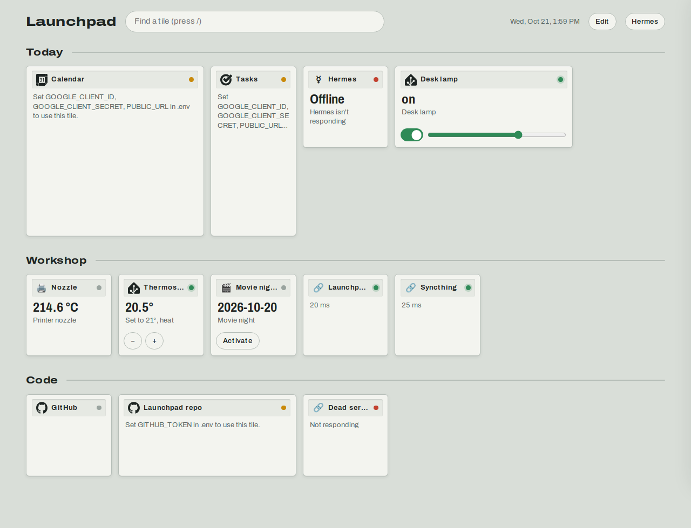
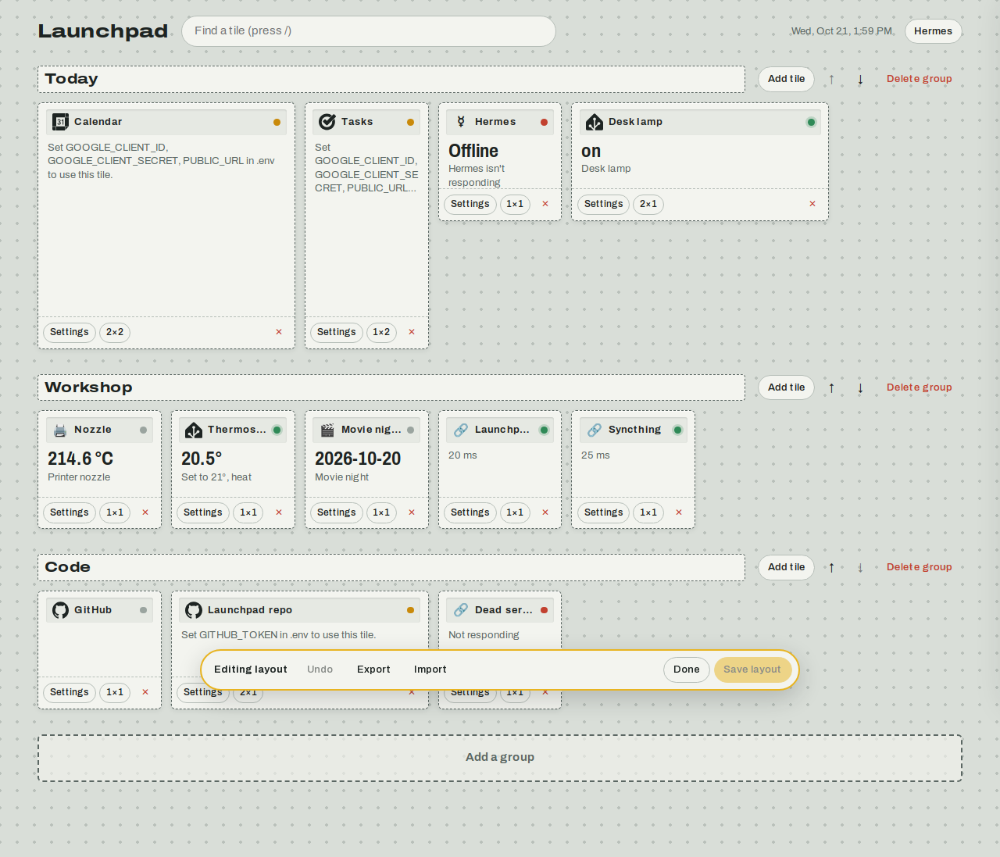

# Launchpad

A tile-based homepage for your projects, sites and devices, with Hermes as a built-in assistant. It runs in Docker and is served privately on your tailnet.



- **Tiles for everything:** links to self-hosted apps (with an up/down check), Home Assistant devices you can switch and dim (one per tile, or a list of several with on/off switches), GitHub repos with CI status and a workflow button, Google Calendar, Google Tasks, NASA's picture of the day.
- **Edit in the page:** drag tiles between groups, resize them, add and configure them from forms. Undo, YAML export and import, and saved revision history.
- **Hermes as the assistant:** chat in a side drawer. Hermes gets Launchpad's GitHub and Google tools over MCP, and controls Home Assistant through its own toolset. Anything that changes something waits for you to approve it on the page.
- **Easy to extend:** an integration is one Python class. Drop it in `config/plugins/` to keep it out of the repo.



## Run it

You need Docker and a Tailscale account.

```sh
git clone https://github.com/LuckyStrix/launchpad && cd launchpad
cp .env.example .env     # set TS_AUTHKEY at minimum
make up                  # creates the launchpad-hermes network, builds, starts
```

Open `https://launchpad.<your-tailnet>.ts.net`. The first run loads `config/layout.example.yaml`. To start from your own layout, put a `config/layout.yaml` in place first.

Each integration shows what it still needs on its tile, such as "Set GITHUB_TOKEN in .env". Fill in `.env` and run `make up` again. `.env.example` explains every variable.

| To use | Set |
|---|---|
| Home Assistant | `HASS_URL`, `HASS_TOKEN` |
| GitHub | `GITHUB_TOKEN` |
| Google Calendar and Tasks | `GOOGLE_CLIENT_ID`, `GOOGLE_CLIENT_SECRET`, `PUBLIC_URL`. Then click the tile to connect your account |
| NASA picture of the day | Nothing. Optionally `NASA_API_KEY` for a higher rate limit |
| Hermes chat | `HERMES_URL`, `HERMES_API_KEY`. See [docs/hermes.md](docs/hermes.md) |
| Hermes using Launchpad's tools | `LAUNCHPAD_MCP_TOKEN`. See [docs/hermes.md](docs/hermes.md) |

Other commands: `make logs`, `make down`, and `make backup` (copies the SQLite database out of its volume).

## Develop

```sh
make dev    # API on :8080 with reload, Vite on http://localhost:5173
make test   # backend tests
make lint   # ruff and svelte-check
```

Without Docker, the backend reads `data/` and `config/` in the repo root.

## Layout of the code

```
backend/app/
  main.py              app factory: wires routers, MCP and the built frontend
  integrations/base.py the integration contract (TileData, Field, @action, @tool)
  integrations/*.py    built-in integrations, one module each
  layout.py            groups and tiles, stored as revisions in SQLite
  tiles.py             tile data, actions and editor pickers
  assistant.py         streaming chat proxy to Hermes
  mcp_server.py        integration tools served over MCP at /mcp
  approvals.py         approve or deny write actions from the UI
frontend/src/
  App.svelte           header, search, edit bar
  lib/Tile.svelte      renders any integration's TileData
  lib/TileEditor.svelte form generated from an integration's fields
  lib/Assistant.svelte Hermes drawer and approval cards
```

- [Adding an integration](docs/adding-an-integration.md)
- [Connecting Hermes](docs/hermes.md)
- [Security notes](docs/security.md)

## License

MIT
